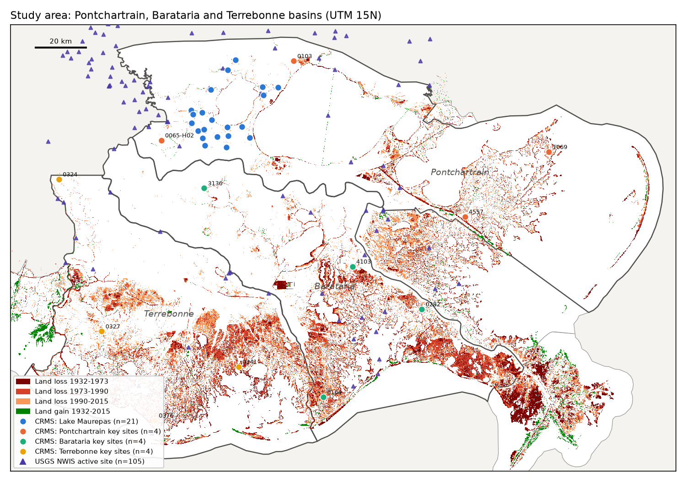
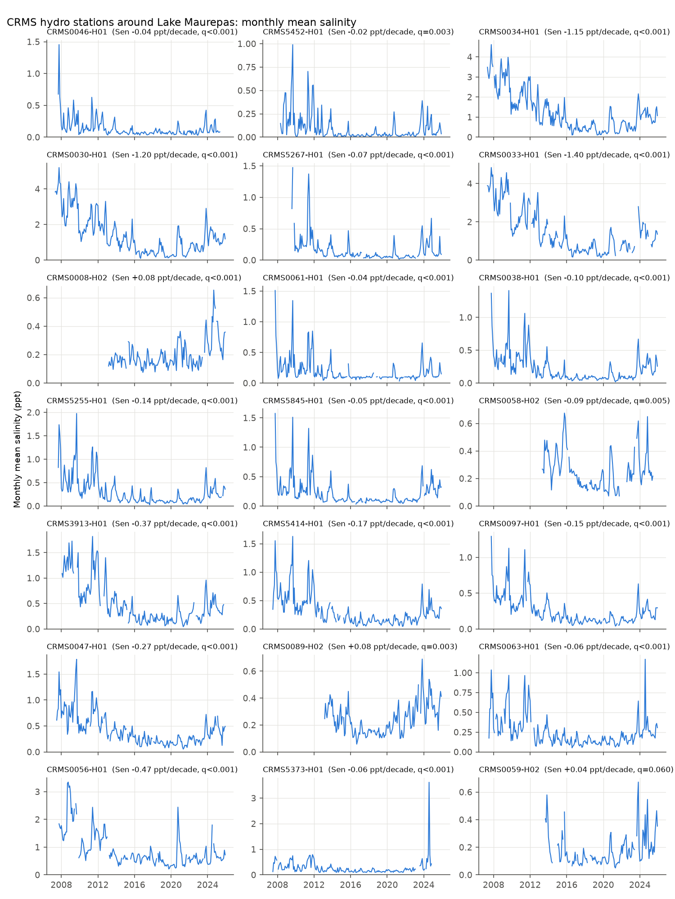
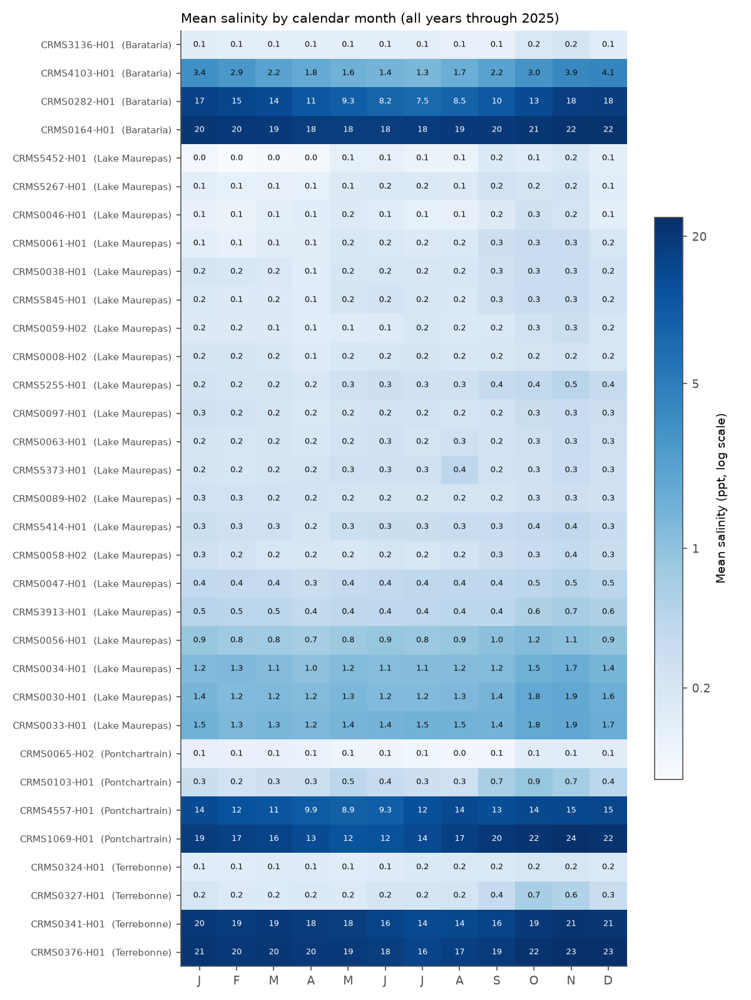
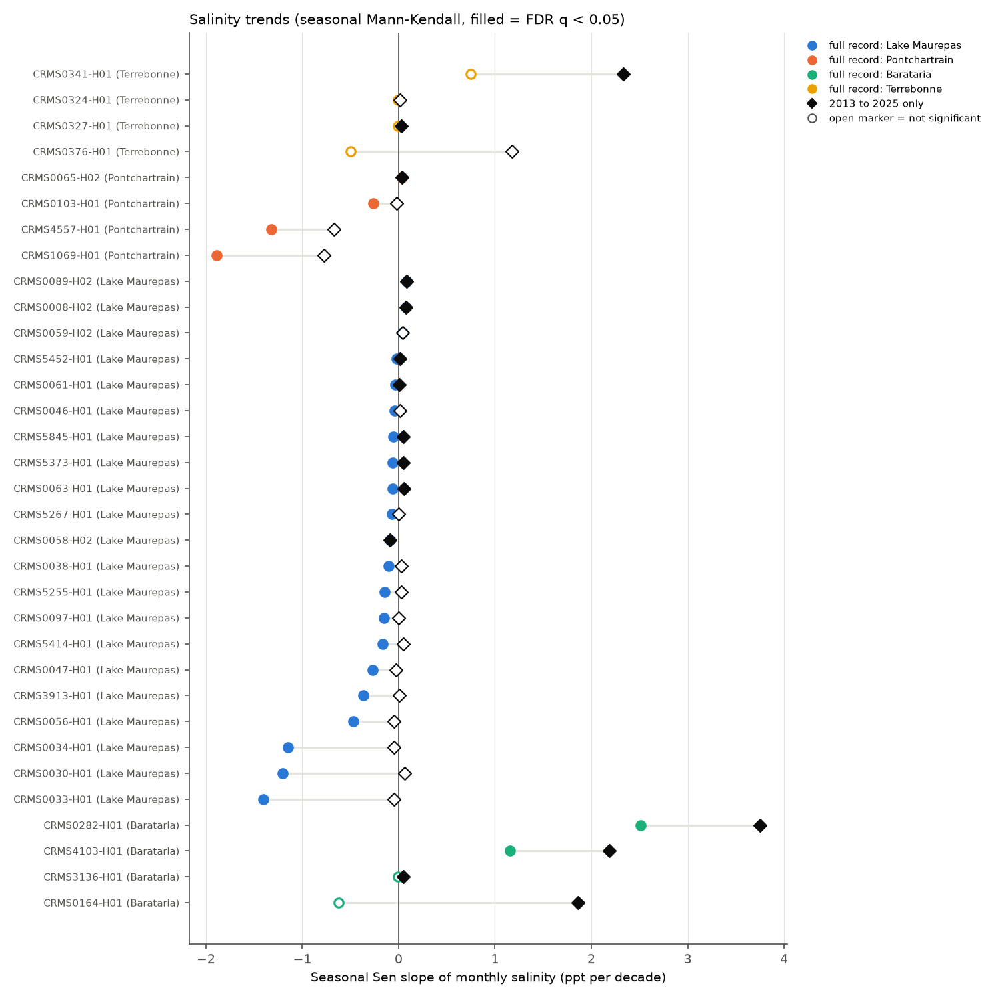
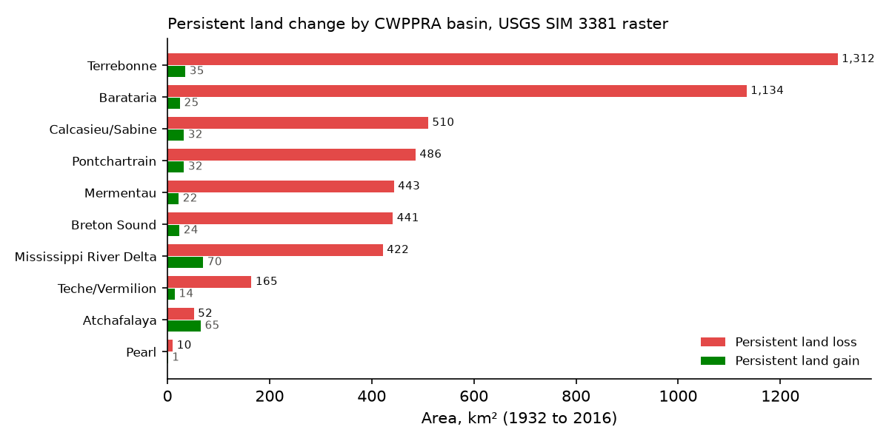
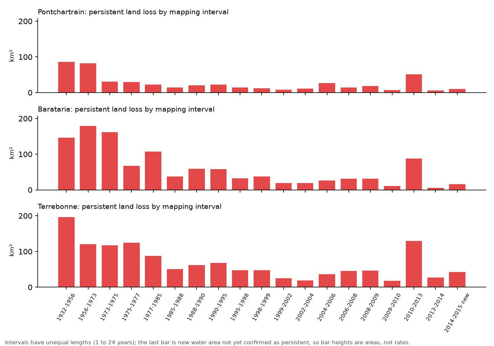

# Louisiana coastal wetlands in Google Earth: CRMS salinity, land loss and monitoring stations

Anamika Dristi, Ph.D.

This repository maps and summarizes coastal wetland change and monitoring stations around Lake Maurepas, Lake Pontchartrain and the Barataria and Terrebonne basins in southeast Louisiana, and packages the results as a Google Earth KMZ. It uses three public sources: the CPRA Coastwide Reference Monitoring System (CRMS) hourly hydrographic record (436 stations, 2.48 million station-days from 2006 to 2026), the USGS persistent land change raster for 1932 to 2016 (Couvillion et al. 2017, SIM 3381), and the USGS NWIS list of active gauges. The Python pipeline tests salinity and water-level trends at 33 CRMS stations (21 around Lake Maurepas and 4 key sites in each of the three basins) with the seasonal Mann-Kendall test, describes the seasonal salinity cycle, totals land loss and gain by CWPPRA basin, draws maps, and builds a KMZ with styled placemarks, HTML balloons with charts, basin outlines, a land change overlay and a guided tour. The KMZ passes validation against the OGC KML 2.2 and Google gx schemas.

This is an independent analysis of public data. It is separate from, and uses none of, the author's LSU dissertation datasets.

## Why it matters

* Environmental scientist and environmental health roles in Louisiana and Texas: salinity intrusion into freshwater swamp and marsh affects drinking-water intakes, cypress-tupelo swamp survival, and fisheries; this repo shows how to pull, clean and test a 15 GB state monitoring record.
* GIS and remote sensing roles: zonal statistics on a 0.85 billion-cell land change raster, basin overlays, and production of files that open directly in Google Earth, QGIS and ArcGIS Pro (KMZ, GeoJSON, CSV with coordinates).
* Coastal restoration and monitoring (CPRA, USGS, consulting firms, postdocs): station-level trend summaries and a land loss table by basin are the kind of products used in CRMS report cards and Coastal Master Plan briefings.

## Data sources

All sources are public and keyless. Accessed 23 October 2026.

| Data | Source and ID | Records used |
|---|---|---|
| CRMS continuous hydrographic data (hourly salinity, water temperature, water elevation to NAVD88) | CPRA Coastal Information Management System (CIMS), full table export `CRMS_Continuous_Hydrographic.zip` (1.29 GB zip, 15.0 GB CSV, file dated 18 Oct 2026), https://cims.coastal.la.gov/FullTableExports.aspx | 436 hydro stations with salinity, 2,484,522 station-days, 17 Feb 2006 to 31 Aug 2026 |
| CRMS hydro station locations | CIMS GIS download, Data Collection Stations (`monitoring_stations.gdb`), https://cims.coastal.louisiana.gov/viewer/metadata/zips/Data_Collection_Stations.zip | 441 CRMS hydrographic station records |
| CRMS site attributes (vegetation type, parish) | CIMS GIS download, CRMS Sites (`crms6298.shp`), https://cims.coastal.louisiana.gov/viewer/metadata/zips/CRMS_Sites.zip | 6,306 sites |
| CWPPRA hydrologic basin boundaries | CIMS GIS download, `BasinsCoastal.shp`, https://cims.coastal.louisiana.gov/viewer/metadata/zips/Basins.zip | 10 basins |
| Persistent land change 1932 to 2016 | Couvillion, B.R., Beck, H., Schoolmaster, D., Fischer, M., 2017, USGS Scientific Investigations Map 3381, https://doi.org/10.3133/sim3381. Raster `sim_3381_persistent_change_spatial_data_092616.img`, ScienceBase item 5a67a8cde4b06e28e9c57150 | 42,889 x 19,763 cells at 15 m |
| USGS NWIS active surface-water sites | USGS Water Services site service with series catalog, box -91.30, 28.90 to -89.60, 30.60 | 105 active sites with instantaneous values |

Exact URLs are in `scripts/config.py`. Big files (the CRMS zip and the raster) are not stored here; `scripts/01_download_data.py` fetches them.

## Methods

1. **Daily means** (`02_build_crms_daily.py`, `02_daily.awk`). The 15 GB hourly CSV is streamed from the zip (never unpacked) and reduced to one row per station and day: mean adjusted salinity (ppt), adjusted water temperature, and adjusted water elevation to datum (ft NAVD88), with the number of hourly values and the geoid model. Only surface-water hydro stations (IDs ending in -H01, -H02) are kept. A daily mean needs at least 12 hourly values.
2. **Station selection** (`03_select_stations.py`). Station points are joined to CWPPRA basins. The Lake Maurepas group is every CRMS hydro station within 22 km of the lake centre (30.255 N, 90.515 W) with at least 8 years of record (21 stations). For each of Pontchartrain, Barataria and Terrebonne, 4 key sites outside the Maurepas group were taken evenly along latitude (north to south) from stations with at least 10 years of daily salinity and data in 2025, so each set spans fresh to saline conditions. NWIS sites were tagged by the parameters they report.
3. **Trends and seasonality** (`04_salinity_trends.py`). Daily values become monthly means (a month needs 15 valid days). Trends use the seasonal Mann-Kendall test (Hirsch et al. 1982, `pymannkendall.seasonal_test`, period 12) with the seasonal Sen slope, on all months through December 2025. Because many stations started in 2007 to 2008 during a salty period, the test was repeated on a common 2013 to 2025 window. P values were adjusted across the 33 stations with the Benjamini-Hochberg false discovery rate (q). Water-level trends used only the longest run of days on one geoid model (GEOID12B, October 2013 onward at every station) so datum updates cannot create a false trend. The seasonal cycle is the mean of monthly means by calendar month.
4. **Land change by basin** (`05_land_loss_by_basin.py`). The SIM 3381 raster (values 1 to 19 = land lost in a mapping interval, 20 to 38 = land gained, 0 = no persistent change) was read in strips, the basin polygons were rasterized on the same 15 m grid, and cells were counted by basin and class (each cell is 225 m2).
5. **Maps** (`06_maps.py`): study area with basins, land change (shown at about 150 m), stations and NWIS sites. GeoJSON copies of the station and basin layers are in `data/`.
6. **KMZ** (`07_build_kmz.py`, simplekml): see the next section.
7. **Validation** (`08_validate_kml.py`): lxml parse, XSD validation against OGC KML 2.2 plus the Google gx 2.2 extension schema, and checks that every image is inside the KMZ, every point lies in the study box, and every tour balloon update points to an existing placemark. Report: `outputs/tables/kml_validation_report.txt`.

## Google Earth KMZ

`outputs/kmz/louisiana_coastal_wetlands.kmz` (1.3 MB) holds:

* 33 CRMS station placemarks, coloured by group, each with an HTML balloon (median and 10th to 90th percentile salinity, days above 2 ppt, saltiest and freshest month, seasonal range, full-record and 2013 to 2025 trends with FDR q, water-level trend) and a small salinity chart stored inside the KMZ;
* 105 USGS NWIS sites with the parameters each reports and a link to its USGS page;
* the 10 CWPPRA basin outlines, with land loss totals in the basin balloons;
* a ground overlay of persistent land change for the three study basins (about 90 m display cells, off by default);
* a gx:Tour that starts over the coast, flies to Lake Maurepas, visits 7 Maurepas stations spread around the lake and the 12 basin key sites, and opens each balloon in turn (19 stops, 22 FlyTo steps).

How to open it in Google Earth Pro or Google Earth Web, use historical imagery, and save a screenshot or a video of the tour: [`docs/GOOGLE_EARTH_GUIDE.md`](docs/GOOGLE_EARTH_GUIDE.md).

Google Earth itself was not available in the environment where this was built. The KMZ was validated with a schema parser, not opened in Google Earth; open it once before using screenshots of it.

## Key findings

Salinity around Lake Maurepas

* The Maurepas stations are fresh: the median of the 21 station medians is 0.19 ppt. Only the three oligohaline marsh stations on the Manchac land bridge east of the lake, between Lake Maurepas and Lake Pontchartrain (CRMS0030, CRMS0033, CRMS0034, medians 0.93 to 1.17 ppt), exceed 2 ppt on more than 5 % of days (20 to 27 % of days); CRMS0056 does on 7 %.
* The seasonal cycle is consistent: 16 of 21 stations are saltiest in November (the rest in August to October) and 14 of 21 are freshest in April, matching low autumn river flow and spring floods. The cycle is small, a median range of 0.21 ppt between the highest and lowest monthly means.
* Over the full record (2007 to 2025 at most stations), 18 of 21 stations show a significant decrease (FDR q < 0.05) and 2 an increase. The largest declines are at the three Manchac land bridge stations (-1.15 to -1.40 ppt per decade).
* That decline comes from the early years. The records begin in 2007 to 2008, after Hurricanes Katrina and Rita and around Gustav (2008) and the 2011 drought, when salinity was high (Figure 2). On the common 2013 to 2025 window only 1 Maurepas station still declines; 7 show small significant increases (median slope +0.015 ppt per decade) and the rest show no trend. The 2023 low-flow autumn is visible as a salinity peak at almost every station. The 2013 to 2025 increases are small, at most +0.08 ppt per decade.

Basin key sites

* Barataria: the two mid-basin stations got saltier, CRMS4103 by +1.15 and CRMS0282 by +2.51 ppt per decade over the full record (q < 0.001), and all 4 Barataria sites show significant increases on the 2013 to 2025 window.
* Terrebonne: no full-record trend at any of the 4 sites; 2 show increases on the 2013 to 2025 window (CRMS0341, +2.3 ppt per decade).
* Pontchartrain: the two saline sites east of New Orleans (CRMS1069, CRMS4557) declined over the full record (-1.89 and -1.32 ppt per decade) but not on the 2013 to 2025 window.

Water level

* From October 2013 to 2025 (GEOID12B), monthly water level rose at most stations: median Sen slope 3.7 mm per year at the Maurepas stations (range -0.8 to 13.5; 9 of 21 significant) and 5.5 to 8.4 mm per year (median by basin) at the basin key sites, where 9 of 12 are significant. These are short records that end with high-water years and are affected by river stage, so they are not sea-level rise rates.

Land loss by basin (USGS SIM 3381 raster, 1932 to 2016)

| Basin | Persistent loss, km2 | Persistent gain, km2 | Net, km2 | Loss as % of mapped area |
|---|---|---|---|---|
| Terrebonne | 1,312 | 35 | -1,277 | 16.8 |
| Barataria | 1,134 | 25 | -1,109 | 15.9 |
| Calcasieu/Sabine | 510 | 32 | -478 | 18.5 |
| Pontchartrain | 486 | 32 | -453 | 4.4 |
| Mermentau | 443 | 22 | -421 | 12.7 |
| Breton Sound | 441 | 24 | -418 | 16.1 |
| Mississippi River Delta | 422 | 70 | -352 | 20.0 |
| Teche/Vermilion | 165 | 14 | -150 | 5.3 |
| Atchafalaya | 52 | 65 | +14 | 3.4 |
| Pearl | 10 | 1 | -9 | 8.5 |
| All coastal basins | 4,975 | 321 | -4,654 | 11.9 |

* Terrebonne and Barataria together hold half (49 %) of all persistent loss on the coast. Atchafalaya is the only basin with net gain (delta growth).
* The coastwide net of -4,654 km2 is close to the -4,833 km2 published in SIM 3381; the gap is expected because this layer holds persistent change only, and 56 km2 of loss falls outside the basin polygons.
* In each of the three study basins the largest single-interval loss came before 1977, with a second, smaller peak in the 2010 to 2013 interval (Figure 6).

Monitoring network

* Of the 105 active NWIS sites in the study box, 104 report gage height, 32 discharge, 26 specific conductance and 25 salinity; 44 lie inside the Pontchartrain, Barataria or Terrebonne basin.

## Figures



*Figure 1. Study basins, persistent land change (USGS SIM 3381), the 33 analysed CRMS stations and 105 active USGS NWIS sites.*



*Figure 2. Monthly mean salinity at the 21 Lake Maurepas stations, with full-record seasonal Sen slope and FDR q.*



*Figure 3. Mean salinity by calendar month (log colour scale).*



*Figure 4. Seasonal Sen slopes for the full record (circles) and 2013 to 2025 (diamonds); filled markers have FDR q < 0.05.*



*Figure 5. Persistent land loss and gain by CWPPRA basin, 1932 to 2016.*



*Figure 6. Persistent land loss by mapping interval in the three study basins. Intervals differ in length, so bars are areas, not rates.*

## Limitations

* CRMS data are used as published ("adjusted" columns). Sensor gaps, relocations (several sites moved from -H01 to -H02 in 2013) and servicing are not corrected further.
* Trend results depend on the window. Full-record trends at Maurepas are driven by high salinity in 2007 to 2012; this is why both windows are reported. Station records are 12 to 19 years, short for climate trends.
* The seasonal Mann-Kendall test here does not correct for serial correlation between years, so p values may be too small; the FDR adjustment does not fix that.
* Water level trends are on 2013 to 2025 only, depend on benchmark ties to NAVD88 at each station, and are strongly affected by river stage and storm years.
* USGS states that the persistent change layer is not meant for rate calculations or for the landscape at a single date; this repo reports only areas. Interval labels follow the raster attribute table; loss class 18 is labelled "2010-2014" in the file while the matching gain class is "2013-2014", and the last class ("2014-2015 new water area") is change not yet confirmed as persistent. Totals refer to the area the raster covers inside each basin polygon.
* The land change overlay and maps are shown at 90 to 150 m with nearest-neighbour resampling; small features are under-drawn. All statistics use the full 15 m raster.
* Key sites were chosen by a simple rule (evenly along latitude); a different rule would give different examples.
* NWIS sites are listed and mapped only; their data were not analysed.
* Google Earth Pro, Google Earth Web and ArcGIS Pro were not run. The KMZ was validated against the KML schemas only.

## How to run

Needs Python 3.11 or newer, `unzip` and `awk` (macOS or Linux; use WSL on Windows), about 1.5 GB of disk for downloads, and about 15 minutes (most of it the download and the 15 GB stream).

```bash
python -m venv .venv
source .venv/bin/activate
pip install -r requirements.txt
# optional: keep big downloads outside the repo
export LCW_RAW_DIR=/path/to/space
bash scripts/run_all.sh
```

Or run the numbered scripts one at a time with `python -I scripts/0N_name.py`. The `-I` flag keeps Python from importing modules from the download folders.

### Steps for the author to run before citing this work

1. Re-run `bash scripts/run_all.sh` and compare the tables with the numbers above (CRMS data are updated weekly, so the latest months will change).
2. Open the KMZ in Google Earth Pro, check the station positions, balloons, overlay alignment and tour, and record the tour video (see the guide).
3. Optional: open `data/*.geojson` or the KMZ in ArcGIS Pro (KML To Layer) or QGIS and confirm the layers draw correctly.

## Repository structure

```
louisiana-coastal-wetlands-google-earth/
  README.md, LICENSE, requirements.txt, .gitignore
  docs/GOOGLE_EARTH_GUIDE.md        how to open, explore, screenshot and record the KMZ
  scripts/
    config.py                       paths, URLs and study settings
    01_download_data.py             fetch all public inputs
    02_build_crms_daily.py          stream 15 GB hourly CSV to daily means (uses 02_daily.awk)
    03_select_stations.py           basins, station selection, NWIS site table
    04_salinity_trends.py           seasonal Mann-Kendall, climatology, charts
    05_land_loss_by_basin.py        zonal land change by basin, KMZ overlay
    06_maps.py                      study area map, GeoJSON exports
    07_build_kmz.py                 Google Earth KMZ (simplekml)
    08_validate_kml.py              schema and structure checks
    run_all.sh
  data/
    crms_stations_selected.csv / .geojson   33 analysed stations
    crms_selected_daily.csv.gz              daily means for those stations
    nwis_sites_study_area.csv / .geojson    105 NWIS sites
    basins_coastal_simplified.geojson       CWPPRA basins (simplified 150 m)
  outputs/
    figures/                        fig1 to fig6
    tables/                         station summary, climatology, group summary,
                                    land change by basin and by period,
                                    CRMS hydro station inventory, KML validation report
    kmz/louisiana_coastal_wetlands.kmz
```

## Citation and author

Anamika Dristi, Ph.D. (2026). Louisiana coastal wetlands in Google Earth: CRMS salinity, land loss and monitoring stations. Code: MIT License. Contact: anamikadristi@gmail.com

Data credits: Coastal Protection and Restoration Authority of Louisiana, CRMS and CIMS (https://cims.coastal.la.gov); Couvillion et al. (2017), USGS SIM 3381, https://doi.org/10.3133/sim3381; U.S. Geological Survey, National Water Information System.

Method reference: Hirsch, R.M., Slack, J.R., Smith, R.A., 1982, Techniques of trend analysis for monthly water quality data, Water Resources Research 18(1):107-121.

Related published work by the author (context only; not used here): Dristi & Xu 2023, Water 15(14):2621; Dristi & Xu 2025, Water 17(17):2589; Dristi et al. 2025, Estuarine, Coastal and Shelf Science 324:109465.
